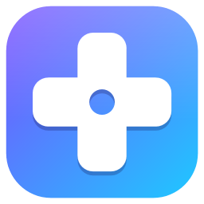

  

<h1 align="center">GameHub</h1>

  All your PC games, emulated games and achievements in one place, on Windows. 
  <b>Beta</b>

---

GameHub finds the games you already have installed from Steam, Epic Games and GOG, adds your own PC games and emulated games next to them, and pulls in covers, artwork, descriptions and achievements. You can browse it at your desk with a mouse and keyboard, or on the sofa with a controller in Console Mode.

## Download

Get the latest **GameHub-Setup-…exe** from the [Releases page](https://github.com/HubWorks-Studio/GameHub-Releases/releases) and run it.

- Windows 10 (1809 or later) or Windows 11, 64-bit.
- It installs for your Windows account without needing admin rights.
- Nothing else is needed first: .NET and everything else GameHub uses come with the installer.
- **GameHub updates itself.** When a new version comes out, a notice offers to install it and GameHub opens again afterwards. You can also check by hand in **Settings > About**.

Uninstalling keeps your library, keys and art (in `%LOCALAPPDATA%\GameHub`), so reinstalling picks up where you left off.

## Features

### One library for everything
- **Steam, Epic Games and GOG** games are found automatically and start through their own launcher.
- **EA app and Xbox app** games are listed as well.
- **Ubisoft Connect and Battle.net** are detected and shown as installed, though their games can't be added yet.
- **Any other PC game:** pick its .exe, or drag it onto the window. GameHub tracks how long you play.
- **Emulated games** from your ROM folders, for every system your emulators cover. Multi-disc games are combined into one entry, and each game can use its own emulator.
- Notices installs and uninstalls as they happen. Filters, search, sorting, favourites, and covers, hero or list views.

### Rich game pages
- Covers, hero images, logos and icons from **SteamGridDB**, with alternative art to choose from.
- Descriptions, ratings and time-to-beat from **IGDB**.
- Steam playtime, achievements and installed DLC.
- A wrong match can be corrected by hand.

### RetroAchievements
- Emulated games are identified with RetroAchievements' own hashing rules.
- Game pages show each achievement's badge and whether you've unlocked it, plus your completion percentage.
- For each emulator, GameHub shows whether RetroAchievements is switched on and signed in.
- A single page gathers the achievement progress for all your games.

### GameHub Player, the built-in emulator
Play straight from GameHub, with nothing else to set up:

NES · SNES · Game Boy, Game Boy Color and Game Boy Advance · Nintendo 64 · Nintendo DS · Mega Drive / Genesis · Saturn · Dreamcast · PlayStation · PSP · Commodore 64 · Arcade

- Cores download when you first need them, and you can choose another core for each system.
- In-game menu with save states and memory cards.
- RetroAchievements built in, with popups whose size and position you can change.
- A BIOS folder for systems that need one.

### Your own emulators
- Presets for RetroArch, Dolphin, PCSX2, DuckStation, PPSSPP, RPCS3, Xemu, Cemu, Eden and VICE, or set up any other emulator yourself.
- GameHub looks for installed emulators automatically.
- It can tell you when an emulator has an update, and install it before you play.
- **RetroArch:** download cores and change RetroArch's main settings from inside GameHub.

### Console Mode
A full-screen view made for controllers (press **F11**, or start GameHub in it):
- Shelves of games by platform, with pictures you can choose.
- Sounds, background music, and sound and music packs you can add.
- Screensavers.
- Full Settings, with an on-screen keyboard.
- A button combination (L3 + R3 by default) to come back from a game.
- Xbox and PlayStation controllers.

### Everything else
- Dark, light or follow-Windows theme.
- Daily library backups to a folder or cloud-synced drive.
- Start with Windows.
- A first-time setup guide.
- A [user guide](GameHub-User-Guide.pdf) (PDF), also opened from **Settings > About**.

## Getting started

1. Install and open GameHub. The setup guide walks you through the rest.
2. In **Settings > Keys**, enter the API keys you want to use. Each is optional, but some features need them:

   | Service | Used for | Where to get it |
   |---|---|---|
   | SteamGridDB API key | Covers and artwork | [steamgriddb.com/profile/preferences/api](https://www.steamgriddb.com/profile/preferences/api) |
   | IGDB (Twitch Client ID + Secret) | Descriptions, ratings, time to beat | [dev.twitch.tv/console/apps](https://dev.twitch.tv/console/apps) |
   | Steam Web API key + SteamID64 | Steam playtime and achievements | [steamcommunity.com/dev/apikey](https://steamcommunity.com/dev/apikey) |
   | RetroAchievements username + Web API key | Achievements for emulated games | [retroachievements.org/settings](https://retroachievements.org/settings) |

   Keys are stored only on your PC, encrypted with Windows' own protection for your account, and are sent only to the service they belong to.
3. Add your ROM folders and emulators in **Settings > Emulators**, if you play emulated games.
4. Press **Play**.

## Privacy

GameHub has no account, no telemetry and no ads. It only connects to the services above, using your own keys, and to GitHub to check for updates.

## Reporting a problem

GameHub is in beta, so things may go wrong. When something does, please open an [issue](https://github.com/HubWorks-Studio/GameHub-Releases/issues) with:
- the version, shown in **Settings > About**;
- what you did, and what happened;
- the log, from `%LOCALAPPDATA%\GameHub\logs\launcher.log`.

The **Copy** button next to System specs in **Settings > About** copies your PC's details to paste in too.

## Credits

Game data comes from [IGDB.com](https://www.igdb.com/), art from [SteamGridDB](https://www.steamgriddb.com/) and its artists, achievements from [RetroAchievements.org](https://retroachievements.org/), Steam data from Steam's Web API, and console logos from [Simple Icons](https://simpleicons.org/) (CC0). GameHub is built with [rcheevos](https://github.com/RetroAchievements/rcheevos), [Gameloop.Vdf](https://github.com/shravan2x/Gameloop.Vdf), the [.NET Community Toolkit](https://github.com/CommunityToolkit/dotnet), the [Windows App SDK](https://github.com/microsoft/windowsappsdk) and [.NET](https://github.com/dotnet/runtime).

Steam, Epic Games, GOG, PlayStation, Xbox, Nintendo, Sega and other names and logos are trademarks of their owners. GameHub isn't affiliated with or endorsed by any of them, or by the services above. GameHub doesn't come with any games, ROMs or BIOS files.
